# 💼 JobBoard - Plateforme de Recrutement en Microservices

## 📝 Description du Projet

**JobBoard** est une plateforme de recrutement conçue selon une architecture microservices : gestion des candidats, des offres d'emploi, des candidatures, des entretiens et des notifications.

Dans le cas d'une montée en charge, chaque microservice peut être lancé en **plusieurs instances**. Il faut alors un **registre** de toutes les instances disponibles pour répartir la charge entre elles. C'est le rôle de **Netflix Eureka** : chaque microservice s'y enregistre au démarrage, puis les services se retrouvent grâce à leur **nom** (`spring.application.name`) au lieu d'une adresse écrite en dur.

Comme Eureka expose une **API REST**, des microservices écrits dans des langages différents (Java, JavaScript, Python) peuvent tous s'y enregistrer. C'est le cas de notre projet.

## 👥 Équipe

**Classe / Groupe :** 4Actuariat - Groupe 7

- **Racha Khammassi**
- **Cyrine Boukhit**
- **Mariem Cherif**
- **Zeyneb Chouchene**

## 🎯 Atelier 1 : Implémentation « Eureka server »

### Objectifs
- ✅ Créer un serveur de découverte **Eureka**.
- ✅ Enregistrer les microservices Spring Boot **Candidat**, **Job** et **Candidature** comme clients Eureka.
- ✅ Instancier un microservice plusieurs fois et observer ses instances dans Eureka.
- ✅ Enregistrer les microservices **Node.js** (Meeting) et **Python** (Notification) dans Eureka.

## 🏗️ Architecture Globale

L'architecture repose sur les technologies suivantes :

- **Eureka Server** (Spring Cloud Netflix) pour la découverte de services.
- **Spring Boot** pour les microservices Candidat, Job et Candidature.
- **Node.js / Express** avec `eureka-js-client` pour le microservice Meeting.
- **Python / FastAPI** avec `py-eureka-client` pour le microservice Notification.
- **H2** et **MySQL** pour la persistance des données.

### Découpage des Microservices

| Microservice | Technologie | Port(s) | Base de données | Nom dans Eureka |
|---|---|---|---|---|
| **Eureka Server** (`discovery`) | Spring Boot | 8761 | – | – |
| **Candidat** | Spring Boot | 8081 | H2 (en mémoire) | `CANDIDAT` |
| **Job** | Spring Boot | 8082 | MySQL | `JOB` |
| **Candidature** | Spring Boot | 8085 | – | `CANDIDATURE` |
| **Meeting** | Node.js / Express | 8083, 8093 | – | `MEETING` |
| **Notification** | Python / FastAPI | 8084, 8094 | – | `NOTIFICATION` |

## ⚙️ Configuration Eureka

### 🧭 Serveur Eureka (`discovery`)
- Dépendance `spring-cloud-starter-netflix-eureka-server`.
- Annotation `@EnableEurekaServer` sur la classe principale.
- `application.properties` :
  ```properties
  spring.application.name=discovery
  server.port=8761
  eureka.client.register-with-eureka=false
  eureka.client.fetch-registry=false
  ```

### ☕ Clients Spring Boot (Candidat, Job, Candidature)
- Dépendance `spring-cloud-starter-netflix-eureka-client` (avec la BOM Spring Cloud).
- Annotation `@EnableDiscoveryClient` sur la classe principale.
- `application.properties` :
  ```properties
  eureka.client.service-url.defaultZone=http://localhost:8761/eureka
  eureka.client.register-with-eureka=true
  eureka.client.fetch-registry=true
  eureka.instance.prefer-ip-address=true
  ```

### 🟩 Client Node.js (Meeting)
- Dépendance `eureka-js-client`.
- Enregistrement sous le nom `MEETING` au démarrage de l'application.
- Port lu dans la variable d'environnement `PORT`, ce qui permet de lancer plusieurs instances.

### 🐍 Client Python (Notification)
- Dépendance `py-eureka-client` dans `requirements.txt`.
- Enregistrement sous le nom `NOTIFICATION` au démarrage de FastAPI (événement `lifespan`), avec l'URL `http://localhost:8761/eureka`.
- Arrêt du client Eureka (désinscription) à l'arrêt de l'application.
- Port lu dans la variable `PORT` ou dans l'argument `--port` d'uvicorn, ce qui permet de lancer plusieurs instances.

## 📸 Dashboard Eureka

Les cinq microservices sont enregistrés en même temps, avec **deux instances de MEETING** (8083, 8093) et **deux instances de NOTIFICATION** (8084, 8094).

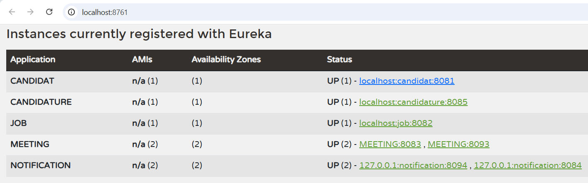

## 🩺 Atelier 2 : Observabilité avec Spring Boot Actuator

Eureka ne connaît que le **heartbeat** de chaque instance : si la base MySQL de Job tombe, le processus tourne toujours et l'instance reste UP. **Spring Boot Actuator** expose l'état interne d'un microservice (santé, informations, métriques) sous `/actuator`. Relié à Eureka, il fait remonter la **vraie santé** du service dans l'annuaire.

### Objectifs
- ✅ Ajouter **Spring Boot Actuator** à Candidat, Job et Candidature et choisir les endpoints exposés.
- ✅ Lire et interpréter `/actuator/health`, `/actuator/info` et `/actuator/metrics`.
- ✅ Publier le statut de santé dans Eureka et observer le passage **UP → DOWN** de Job quand MySQL s'arrête.
- ✅ Exposer des routes `/health` et `/info` pour **Meeting** (Node.js) et **Notification** (Python), déclarées dans Eureka.

### ☕ Configuration Actuator (Candidat, Job, Candidature)
Dépendance ajoutée dans chaque `pom.xml` :
```xml
<dependency>
    <groupId>org.springframework.boot</groupId>
    <artifactId>spring-boot-starter-actuator</artifactId>
</dependency>
```
Propriétés ajoutées dans chaque `application.properties` :
```properties
management.endpoints.web.exposure.include=health,info,metrics
management.endpoint.health.show-details=always
eureka.client.healthcheck.enabled=true
management.info.env.enabled=true

info.app.name=candidat
info.app.version=1.0.0
info.app.description=Microservice de gestion des candidats
info.app.team=4Actuariat - Groupe 7
```

### 🟩🐍 Santé de Meeting et Notification
| Microservice | `/health` | `/info` | Déclaré dans Eureka |
|---|---|---|---|
| Meeting (Node.js) | `{"status":"UP"}` (200) | nom, version, description lus dans `package.json` | `healthCheckUrl` et `statusPageUrl` dans `eureka-js-client` |
| Notification (Python) | `{"status":"UP"}` (200) | nom, version, description | `health_check_url` et `status_page_url` dans `eureka_client.init_async(...)` |

Le lien de chaque instance MEETING et NOTIFICATION dans le dashboard Eureka ouvre maintenant `/info`.

### ✅ Endpoints de supervision

| Microservice | Santé | Informations | Métriques |
|---|---|---|---|
| Candidat | http://localhost:8081/actuator/health | http://localhost:8081/actuator/info | http://localhost:8081/actuator/metrics |
| Job | http://localhost:8082/actuator/health | http://localhost:8082/actuator/info | http://localhost:8082/actuator/metrics |
| Candidature | http://localhost:8085/actuator/health | http://localhost:8085/actuator/info | http://localhost:8085/actuator/metrics |
| Meeting | http://localhost:8083/health | http://localhost:8083/info | – |
| Notification | http://localhost:8084/health | http://localhost:8084/info | – |
| Registre Notification | http://localhost:8761/eureka/apps/NOTIFICATION | | |

### 📸 Captures

**Santé de Job (MySQL démarré) : UP**

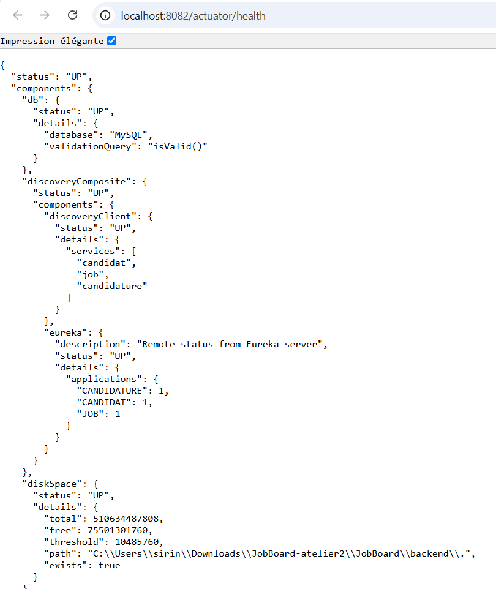

**Panne de MySQL : Job passe DOWN**

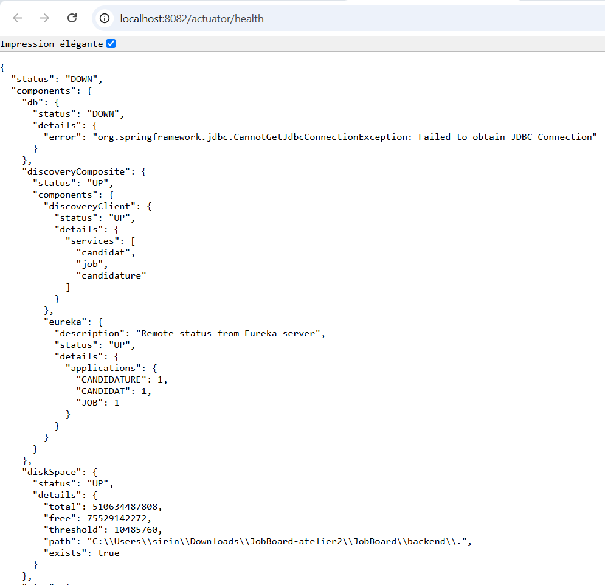

**Dashboard Eureka : JOB affiché DOWN**

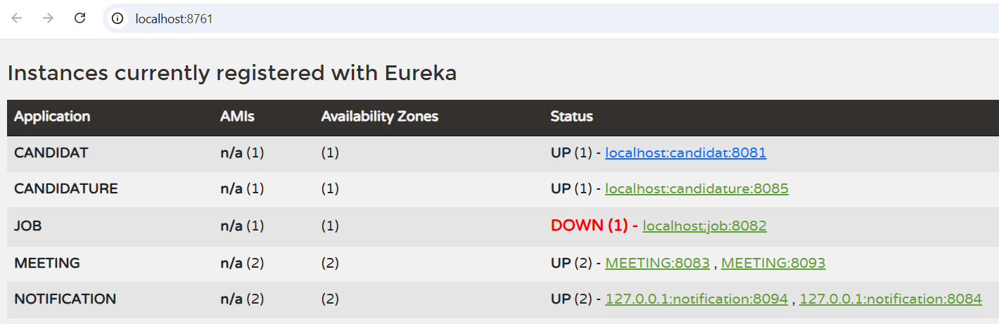

**Informations de Candidat (`/actuator/info`)**

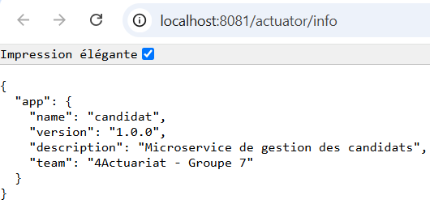

**Métrique `http.server.requests` de Candidat**

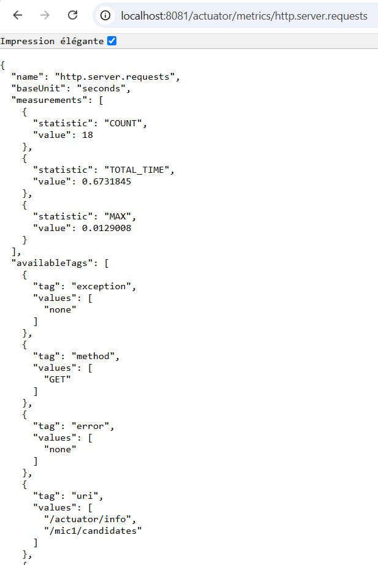

**Métrique filtrée sur les requêtes réussies (`?tag=status:200`)**

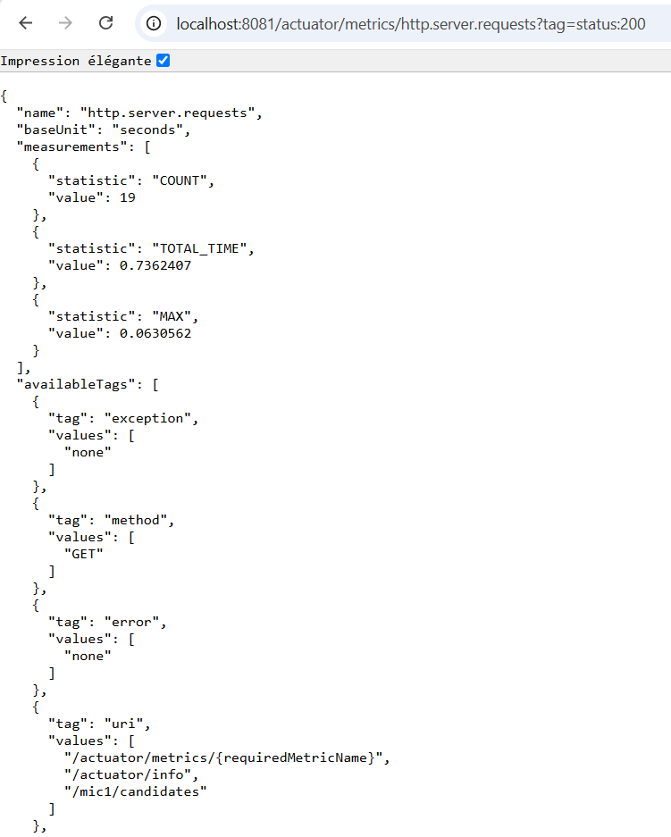

**Santé et informations de Meeting (Node.js)**

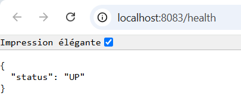

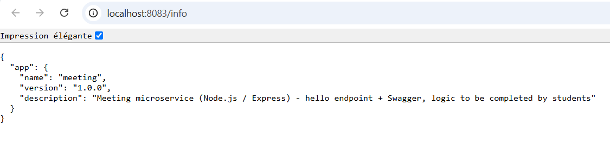

**Santé et informations de Notification (Python)**

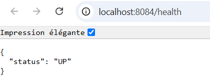

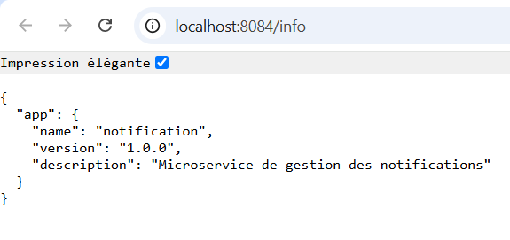

### ❓ Question sur les métriques
> Combien de requêtes HTTP Candidat a-t-il traitées (mesure COUNT) ? Quelle est la durée de la requête la plus lente (mesure MAX) ? Que donne `/actuator/metrics/http.server.requests?tag=status:200` ?

- **COUNT = 18** : Candidat a traité 18 requêtes HTTP (`/mic1/candidates` et `/actuator/info`), pour un temps total de 0,673 s (TOTAL_TIME).
- **MAX = 0,0129 s** (≈ 13 ms) : durée de la requête la plus lente sur la fenêtre de mesure récente.
- **`?tag=status:200`** : la même métrique filtrée sur les seules requêtes réussies (code HTTP 200). On obtient COUNT = 19 et MAX = 0,0631 s : toutes les requêtes ont réussi, donc le filtre n'en retire aucune. La requête supplémentaire est l'appel à `/actuator/metrics/http.server.requests` lui-même, qui apparaît dans le tag `uri`.

## 🚀 Lancement du Projet

### Ordre de démarrage
1. 🐬 **MySQL** (XAMPP ou WAMP), nécessaire pour Job.
2. 🧭 **Eureka Server** : `DiscoveryApplication`
3. ☕ **Candidat**, **Job**, **Candidature** : `CandidatApplication`, `JobApplication`, `CanditatureApplication`
4. 🟩 **Meeting** (deux instances) :
   ```powershell
   cd backend/microservices/meeting
   npm install
   npm start                          # instance 1 : port 8083
   $env:PORT=8093; npm start          # instance 2 : port 8093 (autre terminal)
   ```
5. 🐍 **Notification** (deux instances) :
   ```powershell
   cd backend/microservices/notification
   python -m venv venv
   .\venv\Scripts\Activate.ps1
   python -m pip install -r requirements.txt
   python -m uvicorn app.main:app --port 8084   # instance 1
   python -m uvicorn app.main:app --port 8094   # instance 2 (autre terminal)
   ```

### 🖥️ Dashboard
👉 http://localhost:8761

## ✅ Vérification des Endpoints

| Microservice | Endpoint | Réponse attendue |
|---|---|---|
| Meeting | `GET http://localhost:8083/api/meetings/hello` | `{"message":"hello I'm microservice meeting"}` |
| Notification | `GET http://localhost:8084/api/notifications/hello` | `{"message":"hello I'm microservice notification"}` |
| Candidature | `GET http://localhost:8085/mic3/candidature/hello` | `Hello Im microservice 3!` |
| Candidat | `GET http://localhost:8081/mic1/candidates` | Liste JSON des candidats |
| Job | `GET http://localhost:8082/api/categories` | Liste JSON des catégories |

## 📁 Structure du Dépôt

```
JobBoard/
|-- backend/
|   |-- discovery/                    # Eureka Server (Spring Boot - port 8761)
|   |-- microservices/
|   |   |-- candidat/                 # Spring Boot - H2 (port 8081)
|   |   |-- job/                      # Spring Boot - MySQL (port 8082)
|   |   |-- canditature/              # Spring Boot (port 8085)
|   |   |-- meeting/                  # Node.js / Express (port 8083)
|   |   |-- notification/             # Python / FastAPI (port 8084)
|-- documentation/
|   |-- captures/                     # Captures des ateliers 1 et 2 (Eureka, Actuator)
|   |-- diagrams/                     # Architecture et diagrammes de classes
|-- Scenario_MicroService_explicatif.mp4
|-- README.md                         # Ce fichier
```
